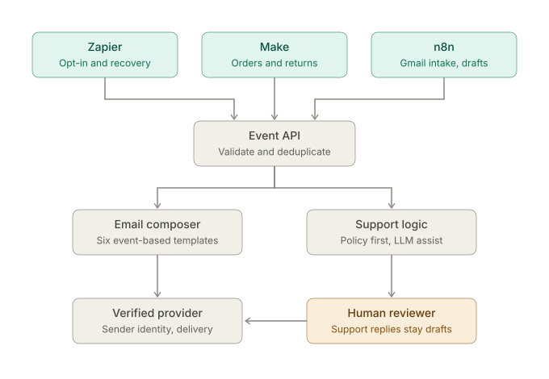
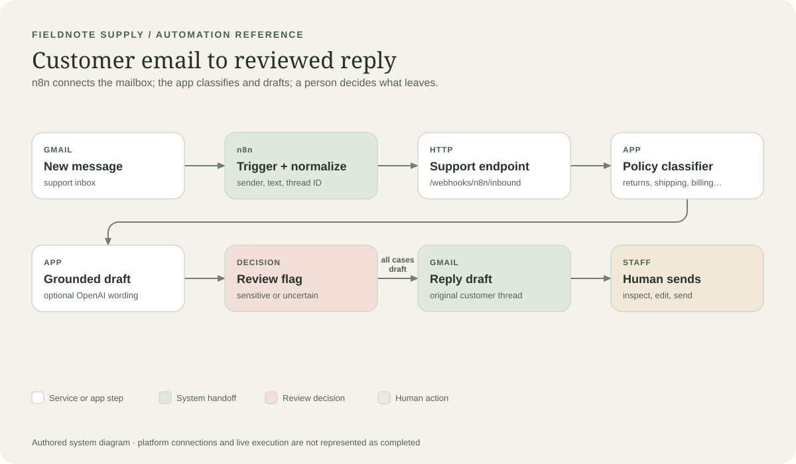
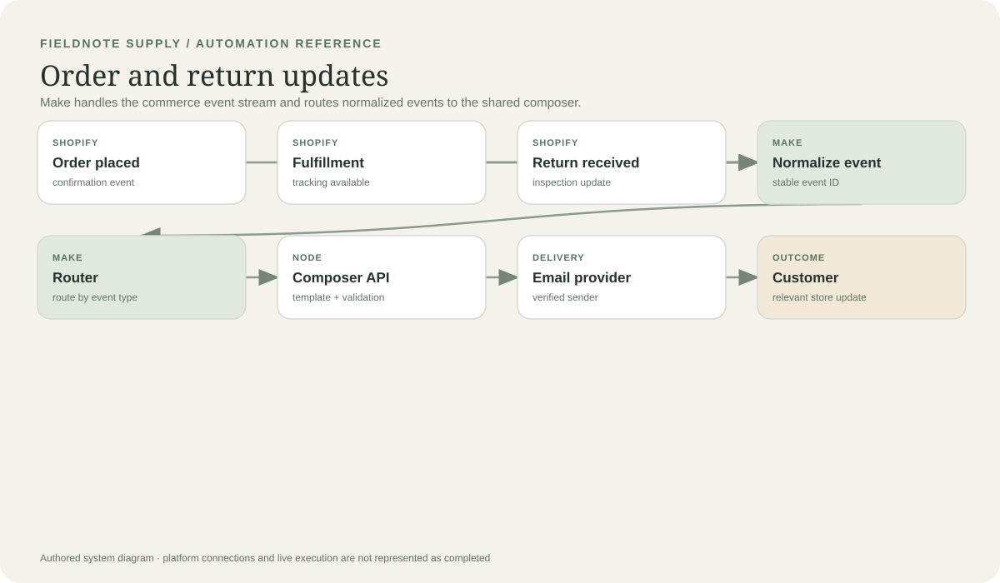
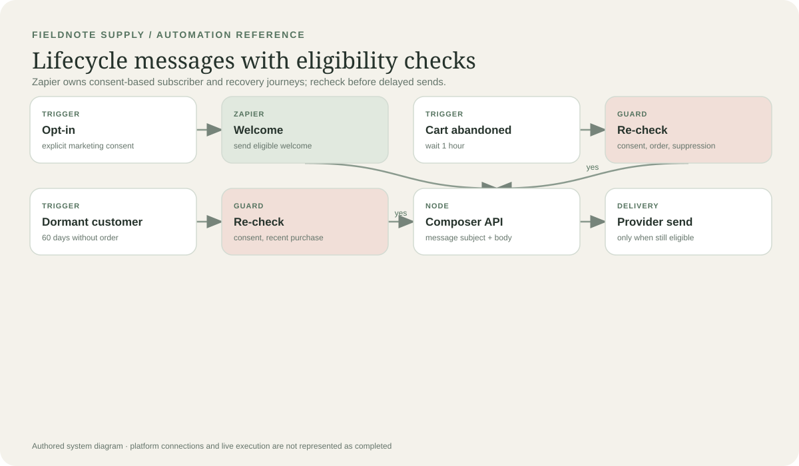

# Fieldnote Supply · Customer Email Operations

> A runnable portfolio prototype for a fictional stationery store: customer lifecycle emails, order updates, and policy-grounded support reply drafts.

  

**Demo mode.** The local app runs without credentials. Gmail, Shopify, n8n, Make, and Zapier accounts are not connected here; the included n8n export is an inactive starter. Local activity is in memory and no mail is actually sent.

## Visual tour

These authored diagrams explain the proposed system; they are not screenshots of live platform canvases. Editable Mermaid sources and SVGs are in [`docs/diagrams/`](docs/diagrams/).

### System map



### Support triage



### Order updates



### Lifecycle campaigns



## What it demonstrates

| Store need | Suggested owner | Outcome |
| --- | --- | --- |
| New subscriber welcome, abandoned cart, and win-back | Zapier | Delayed journeys with consent and post-delay eligibility checks |
| Order confirmation, shipping, and return received | Make | Shopify events routed to the matching customer email |
| Incoming customer questions | n8n | Gmail intake, policy classification, and thread reply draft for staff |

This divides the tools by real work rather than chaining all three for show. The local app provides a shared webhook API and message composer. The actual Make and Zapier scenarios still need to be configured in those accounts; only n8n has a starter export in this repository. See the [platform setup runbook](workflows/README.md).

## Run the local demo

Requires Node.js 18 or newer. There are no package dependencies and no credentials required for the deterministic policy fallback.

```powershell
npm start
```

Open [http://localhost:3000](http://localhost:3000). Use **Run a store event** to preview one of six lifecycle messages, or **Support inbox** to ask about returns, shipping, billing, an order, or a product. Activity resets when the server restarts.

## Optional AI drafting

Copy `.env.example` to `.env`, set `OPENAI_API_KEY`, and restart the server. The app sends the incoming support text and the fictional store policy to the OpenAI Responses API to improve draft wording. Without a key or if the API is unavailable, the policy-based deterministic fallback still creates a draft. The model cannot look up order status, approve refunds, or send email. Keep the key on the server; API usage is billed separately from ChatGPT.

## Connect the email account

For a real demo, connect a dedicated Gmail test account through n8n's credential flow, import [`workflow.json`](workflow.json), and configure the Gmail Trigger, webhook URL, and Gmail draft node. OAuth credentials stay in n8n; the Node service does not need the mailbox password. For Make and Zapier, add the Gmail connection in each platform's account connection UI and configure only the scenario assigned to that event stream. See [mailbox, sender, and webhook setup](workflows/README.md#mailbox-and-api-setup).

Before enabling production webhooks, deploy behind HTTPS, set a long random `WEBHOOK_SECRET` and configure it as a bearer token in platform HTTP requests. Verify a sender domain with the email provider and configure SPF/DKIM/DMARC according to that provider. Do not put secrets in screenshots or commit `.env`.

## Demo and evidence

Use the [two-minute demo script](demo-script.md) to show an order update, a return-policy support draft, and a case that requires human review. The [`screenshots/`](screenshots/) folder contains a checklist for genuine platform captures once the external flows are actually connected. This repository does not include a fabricated execution screenshot or demo video.

## Skills shown

- Workflow ownership and event routing across n8n, Make, and Zapier
- Webhook APIs, payload normalization, validation, bearer authentication, and duplicate handling
- LLM-assisted drafting with a canonical policy source and deterministic fallback
- Email sender and reply-to setup, thread-aware drafts, and a human approval boundary
- Portfolio communication through architecture diagrams, importable workflow JSON, setup runbook, and demo narrative

## Honest project status

The local Node service and the support draft logic are runnable. The n8n JSON is an importable starting point whose Gmail credentials and public app URL must be configured. Make and Zapier recipes are described, not provisioned. No message is delivered from the local app. Before real-store use, add durable storage/idempotency, order lookup, enforced consent and unsubscribe suppression, retries/monitoring, authenticated dashboard access, retention controls, and provider delivery handling.

## Repository map

```text
README.md                    Project overview and honest status
workflow.json                Inactive n8n Gmail support starter
workflows/README.md          n8n, Make, Zapier, mailbox, and API runbook
architecture.md              System boundaries, event contracts, and limits
docs/diagrams/               Editable Mermaid sources and SVG visuals
demo-script.md               Two-minute portfolio walkthrough
knowledge/store-policy.json  Fictional policy and product facts
server.js                    Local HTTP API, event composition, and static server
support-agent.js             Intent routing, fallback, optional AI wording
demo site/                   Local inbox and email operations interface
screenshots/                 Checklist for future genuine platform evidence
.env.example                 Safe configuration template
```
