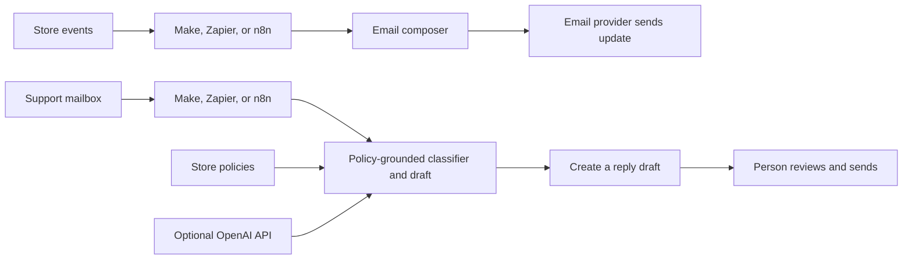

# Fieldnote Supply email operations runbook

This project has two separate flows that meet at the same reviewable email system:

Visual references: [system map](../docs/diagrams/system-map.svg) · [support triage](../docs/diagrams/support-triage.svg) · [order updates](../docs/diagrams/order-updates.svg) · [lifecycle campaigns](../docs/diagrams/lifecycle-campaigns.svg).



Pick one orchestrator for each live trigger. Do not connect all three to the same inbox at once, or each customer message can be processed three times. The platform connections hold Gmail/Shopify credentials; this Node app never needs the store mailbox password.

For a portfolio setup that actually uses all three without duplicate sends, assign one owner per event stream: **n8n owns inbound support and human review**, **Make owns order placed/shipped/return updates**, and **Zapier owns opt-in welcome and delayed cart/win-back campaigns**. Point each stream at its matching provider route. These are distinct jobs, not three copies of one trigger.

## Included email work

### Proactive store updates

The app composes these emails from normalized events:

| Event `type` | Store moment | Email |
| --- | --- | --- |
| `signup` | New subscriber opted in | Welcome and first-order code |
| `order.placed` | Checkout completed | Order confirmation |
| `order.shipped` | Fulfillment has tracking | Shipping update |
| `return.received` | Returned parcel received | Return inspection update |
| `cart.abandoned` | Cart workflow’s delay elapsed | Saved basket reminder |
| `customer.dormant` | Customer workflow’s delay elapsed | Win-back note |

Send an event to `POST /webhooks/{n8n|make|zapier}`. The response contains `event`, `subject`, `text`, and `html`. In the platform, map the response to the provider’s send-email action. `cart.abandoned` and `customer.dormant` must only be sent after the platform has applied its delay and eligibility checks. The local **Run a store event** button is an immediate preview, not a scheduler.

Example event body:

```json
{
  "type": "order.shipped",
  "eventId": "shopify-fulfillment-9402",
  "name": "Jamie Rivera",
  "email": "jamie.rivera@fieldnote.store",
  "orderId": "FN-2048",
  "tracking": "https://fieldnote.store/track/FN-2048"
}
```

Pass a stable `eventId` from the source platform. The server suppresses duplicate events with the same ID during its current process lifetime.

### Incoming customer support email

Send normalized inbound messages to `POST /webhooks/{n8n|make|zapier}/inbound`:

```json
{
  "messageId": "gmail-message-id-123",
  "from": "jamie@example.net",
  "name": "Jamie Rivera",
  "subject": "What is your return policy?",
  "text": "Can I return a notebook if I change my mind?"
}
```

The response contains a support `case` with `category`, `replySubject`, `replyBody`, `reviewRequired`, and `generatedBy`. Pass the stable provider `messageId` to avoid processing the same message twice during this process lifetime. Create a Gmail draft reply from these fields, linked to the original thread. Do not add an automatic-send step.

Categories: `returns`, `shipping_policy`, `order_status`, `billing`, `product_question`, `other`. The policy source is [../knowledge/store-policy.json](../knowledge/store-policy.json). Order status and billing are always flagged for human review; exceptions such as damaged items also need a person. The included demo drafts all replies for review and never sends support responses itself.

## n8n: inbox agent plus store updates

The supplied image is a useful pattern: a Gmail trigger, classification, separated routes, and an action per route. Keep the classification grounded and let the Gmail action create a draft first.

**Support inbox workflow**

1. Add a **Gmail Trigger** on the support mailbox for new messages. Use a filter/label for customer mail and exclude messages sent by the store itself.
2. Normalize `id` → `messageId`, `from` → `from`, `fromName` → `name`, `subject` → `subject`, and the plain-text body → `text`.
3. Use an **HTTP Request** node: `POST https://YOUR_HOST/webhooks/n8n/inbound`, JSON body from the normalized item. Set `Authorization: Bearer <WEBHOOK_SECRET>`.
4. Use **Gmail → Draft → Create** (or equivalent draft operation) with the original thread ID, `case.replySubject`, and `case.replyBody`. Keep the incoming email unread or label it `AI_DRAFT_READY`.
5. If `case.reviewRequired` is true, add a support label and notify a human in Slack. Never connect this path to Gmail Send.

n8n's Gmail node also supports sending/replying and an approval wait; for this workflow prefer a draft so the support agent can read and edit it before sending. See [Gmail draft operations](https://docs.n8n.io/integrations/builtin/app-nodes/n8n-nodes-base.gmail/draft-operations/) and [message operations](https://docs.n8n.io/integrations/builtin/app-nodes/n8n-nodes-base.gmail/message-operations/).

For the reply draft node, choose **Resource: Draft → Operation: Create**, map the subject/body and original thread ID, and set the support mailbox's reply-to as needed. See [n8n Gmail draft operations](https://docs.n8n.io/integrations/builtin/app-nodes/n8n-nodes-base.gmail/draft-operations/).

**Store events workflow**

Use the store's order/subscriber trigger → Switch on `type` → HTTP Request to `/webhooks/n8n` → Gmail Send using returned `event.subject` and `event.html` (or `event.text`). For cart recovery and win-back, place a Wait node before the HTTP Request and re-check consent, order state, and suppression status after the wait.

## Make: mailhook support and visual routes

Make documents a mailhook-triggered AI agent pattern, and its router can split scenarios by conditions. A mailhook or Gmail **Watch emails** module can be used for inbox intake.

1. Create a mailhook or connect Gmail. For forwarding, use a dedicated filter so the scenario does not ingest its own replies; preserve message/thread headers.
2. Add a filter to exclude store-sent mail and automatic out-of-office responses.
3. Add an HTTP **Make a request** module: `POST https://YOUR_HOST/webhooks/make/inbound` with the normalized JSON body above and `Authorization: Bearer <WEBHOOK_SECRET>`.
4. Route `case.reviewRequired = true` to support notification and a human review queue. For other categories, create a Gmail draft reply. Keep it a draft.
5. For store updates, use Shopify/order and subscriber triggers → Router by event → HTTP request to `/webhooks/make` → Gmail **Send an email** or provider send module mapped from `event.subject` and `event.html`. Run scheduled reminders with a delay and a post-delay order/consent recheck.

See [Make Gmail modules](https://apps.make.com/gmail-modules) for Watch emails, create draft, and send actions, and its [webhooks guide](https://help.make.com/webhooks) for webhook setup.

## Zapier: support triage and event sends

1. Trigger from Gmail **New Email** or **New Conversation** and connect the support mailbox through Zapier's account connection.
2. Add a Filter to ignore the store's own sender address and automated/no-reply mail.
3. Use **Webhooks by Zapier → POST** to `https://YOUR_HOST/webhooks/zapier/inbound`, mapping the incoming message fields and `Authorization: Bearer <WEBHOOK_SECRET>`.
4. Create a Gmail **Draft Reply** with the returned `case.replySubject` and `case.replyBody`. Use Paths or a Filter on `case.reviewRequired` to alert the human reviewer.
5. For store updates, use Shopify events → Paths by `type` → POST to `/webhooks/zapier` → Gmail Send Email (or your transactional provider). Put delay and eligibility rechecks before cart and win-back messages.

Zapier's Gmail integration has **Create Draft Reply**, **Send Email**, and Gmail triggers; some triggers are polling-based, so they may not be immediate. See [Gmail on Zapier](https://help.zapier.com/hc/en-us/articles/8495933589645-How-to-get-started-with-Gmail-on-Zapier) and [email triggers](https://help.zapier.com/hc/en-us/articles/8496293328141-Trigger-Zap-workflows-from-new-emails).

## Official platform references

- [n8n Gmail draft operations](https://docs.n8n.io/integrations/builtin/app-nodes/n8n-nodes-base.gmail/draft-operations/) and [Gmail message operations](https://docs.n8n.io/integrations/builtin/app-nodes/n8n-nodes-base.gmail/message-operations/)
- [Make Gmail modules](https://apps.make.com/gmail-modules) (watch, create draft, and send)
- [Zapier Gmail connection and actions](https://help.zapier.com/hc/en-us/articles/8495933589645-How-to-get-started-with-Gmail-on-Zapier)
- [Zapier email triggers](https://help.zapier.com/hc/en-us/articles/8496293328141-Trigger-Zap-workflows-from-new-emails)

## Mailbox and API setup

- In the selected platform, connect the real mailbox with its OAuth connection (or set up the provider's inbound mailhook). Use `hello@your-verified-domain` as the verified sender and `support@your-verified-domain` as Reply-To. Customer responses then arrive in the support inbox watched by the incoming-mail workflow.
- For outbound updates, verify the sender domain with the email provider. Set SPF/DKIM/DMARC as required by that provider. Keep transactional sending and support replies in the account the owner reviews.
- To use this app's optional LLM, copy `.env.example` to `.env`, add `OPENAI_API_KEY` and optionally `OPENAI_MODEL`, then restart the server. The key is read by the Node server only; it is never returned by `/api/state` or delivered to browser JavaScript. If using Make/Zapier/n8n's own OpenAI integration instead, store that credential in the platform's credential manager and omit the local key.
- Before deployment, generate a long random `WEBHOOK_SECRET` and set it in `.env` and each platform HTTP action's `Authorization: Bearer ...` header. Production mode rejects webhook calls if the secret is missing. Protect the dashboard/direct `/api` routes with deployment-level authentication too.
- The LLM can only rewrite a policy-based draft using [store-policy.json](../knowledge/store-policy.json). It cannot perform order lookups, issue refunds, or send messages. If the API is unavailable, the app falls back to a deterministic policy template.

## Production gaps to close before connecting a real store

This reference runs with in-memory demo activity. Before production use: add persistent case/event storage, durable idempotency, rate-limited webhooks, OAuth secret management, order lookup, consent/unsubscribe enforcement, retention rules, delivery/bounce handling, dashboard authentication, and tests for the selected provider. Use a public HTTPS deployment for platform callbacks; local `localhost` is only reachable from the same machine/network tunnel.
